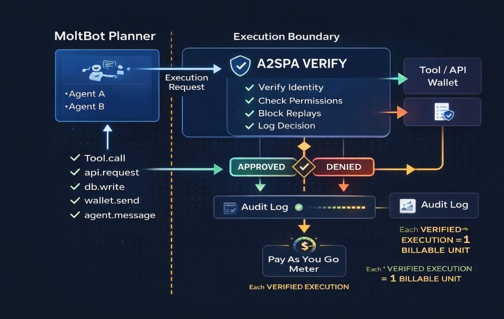

## MoltBot x A2SPA Execution Boundary

This diagram shows how to wrap MoltBot agent execution with A2SPA (Agent-to-Secure Payload Authorization)
as an execution-time authorization gate (`authorized`, `refer_hold`, `denied`, or fail-closed), with audit logging and credit accounting where deployed.

